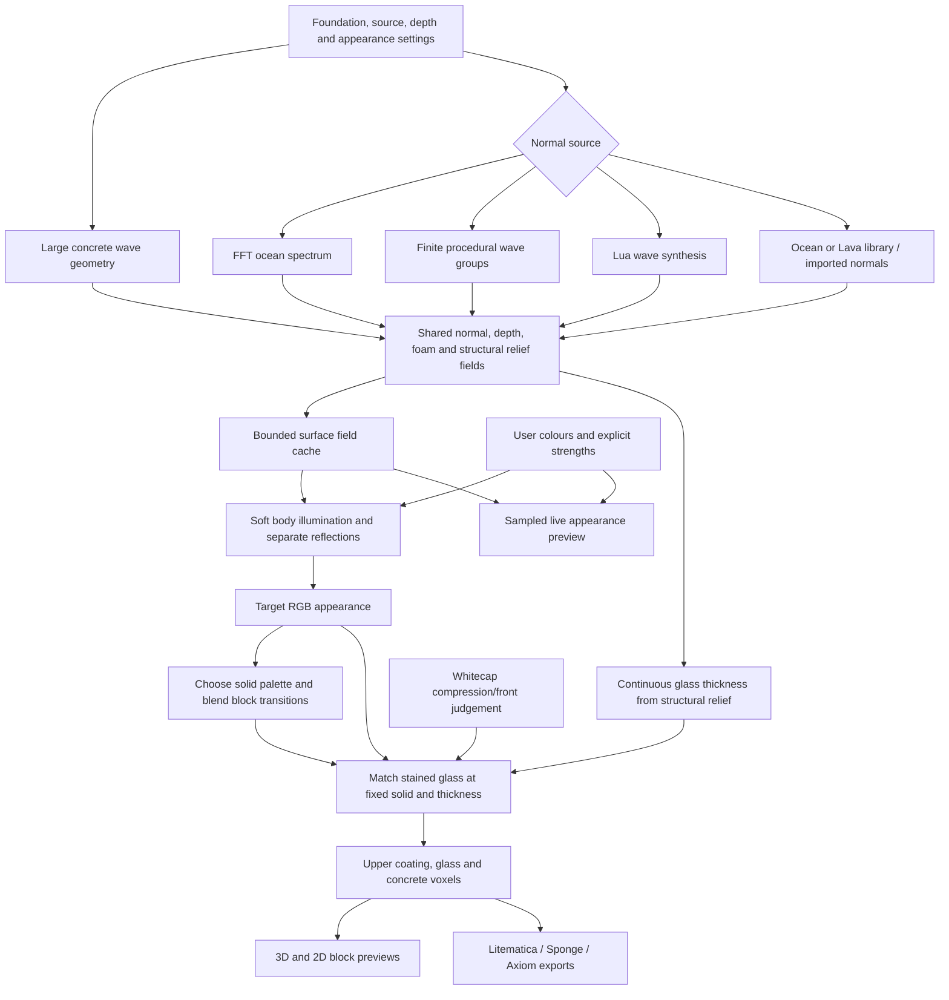

# Current development bake pipeline

Updated 28 October 2026. Public v1.2 was requested again; this describes the released pipeline.
For controls, see USER_GUIDE.md. Older entries in PROJECT_CONTEXT.md are history.

## Fields and lighting
- Foundation and image-map alignment retain their generators. Generated normals now use frequency-dependent FFT spreading or overlapping procedural wave trains; see analysis/generator-review/WAVE_MATH.md.
- Ocean image sources preserve one shared direction and source-normal interiors;
  translated crops blend only narrow joins. Lava Classic remains the default;
  stochastic/quilt alternatives remain experimental.
- Virtual depth affects generation/breaking separately from the new colour controls.
- Generated wave size may follow the foundation peak spacing (`link_scale` with
  `scale_ratio`); generated waves may use an independent heading (`link_direction`
  with `wind_direction`). Imported maps and Lava keep the shared foundation heading.
- Ocean body illumination is .94*smoothstep(.4,1,N dot L)^2 + .06*clamp(N dot L,0,1)^2, softened by the selected
  Gaussian sigma in world blocks. Reflection and foam remain separate sharp fields.
- Let I be softened illumination, S lit strength, C wave shading strength,
  D depth colour influence, R depth colour reach, and d actual virtual depth:
  `J = clamp((I-midpoint)*contrast+.5,0,1)`;
  `lit_weight = clamp(S * (1-C+C*J) * (1+D*(1-smoothstep(0,R,d))), 0, 1)`.
- Mix Water colour and Lit water colour in linear RGB using that weight, then
  overlay reflection and foam with their own masks/colours. CPU and GPU share
  the formula. Concrete Y is not the colour lookup coordinate.
- Defaults are S=.235, C=1, D=.77, R=48 blocks, shadow sigma=3 blocks. These are
  approximate migration values, not a promise of pixel-identical older bakes.

## Materials and structure
- Palette selection uses actual target colours only. Disabled colour roles cannot
  secretly reserve palette slots. Lab plus RGB balance discourages hue errors.
- Existing solid dithering/edge blending and similar-colour replacements remain.
- Glass relief comes from smoothed normal-slope curvature before optical inversion,
  not brightness, palette or heat. Continuous supported cover is resolved first.
- Match ordered stained-glass stacks to the target at each fixed solid and length.
  No clear glass, independent glass direction/scale, or percentage-quota system.
  The layer count is user-selectable 0-3; zero exports the solid coating only.
- Foam hugs the colour layer: the top tint glass is replaced with white glass at
  strong foam and light-grey glass at medium foam. Very faint foam adds one thin
  white layer above the tint stack; the Y-limit check reserves it and it exports as
  the Foam glass layer. Short-wave detail follows the main wave heading and adds
  fine ripples to the normals only; it creates no foam, no glass and no colour
  layer overwrite.
  Glass height follows relief plus foam expression; colour and light edits never
  change glass thickness.
- Approximate tint compositing cannot reproduce every resource pack or shader.
  The Colour preview tab exposes target versus last matched blocks and match error.

## Responsiveness, lifecycle and exports
- Raw Ocean fields use a bounded 96 MiB / three-entry cache, keyed by source,
  geometry, physical settings and imported-file revision. Colour/light edits reuse
  normals and masks. Existing generator caches still operate underneath it.
- A 180 ms debounce schedules a small worker colour preview from saved 192px fields.
  Source and physical changes regenerate a sampled wave field; it never builds
  voxels. The 3D result, blending and export remain stale until successful Bake.
- Bake, cancellation, bounded glass matching and GPU/CPU fallback are retained.
  Full Bake still performs palette matching, voxel construction and mesh generation.
- Exports keep exact geometry; viewport geometry can be sampled. Air-free Litematica
  uses occupied regions. Sponge stores air, so use WorldEdit `//paste -a` when placing.
  Axiom skips empty space. See the Guide for placement.
- Profiles/settings/imported assets and exports are preserved. Release packaging
  is a separate explicit step; development cleanup does not rewrite release ZIPs.

Live preview uses at most 192 pixels per axis. Cached colour/light edits re-shade;
source, foam and depth edits regenerate sampled fields in a cancellable worker.
It runs before the first full bake. It never commits blocks, exports or blending.

Generated FFT/procedural foam defaults to Lua-style crests applied only inside the
existing eligible mask. Legacy foam remains selectable. The v1.3 Lua whitecap style
and the Lua wave source both compute whitecaps from horizontal compression, the
downwind front slope and normalized crest height; map sources keep the existing
foam through the normal-slope compression proxy. Terrain collisions remain out of scope.

Lua-style whitewater is fragmented inside eligible crest areas; residual foam is
derived from upstream whitewater with bounded spatial decay and cannot leave the
original mask. This is static appearance, not temporal collision/fluid simulation.
