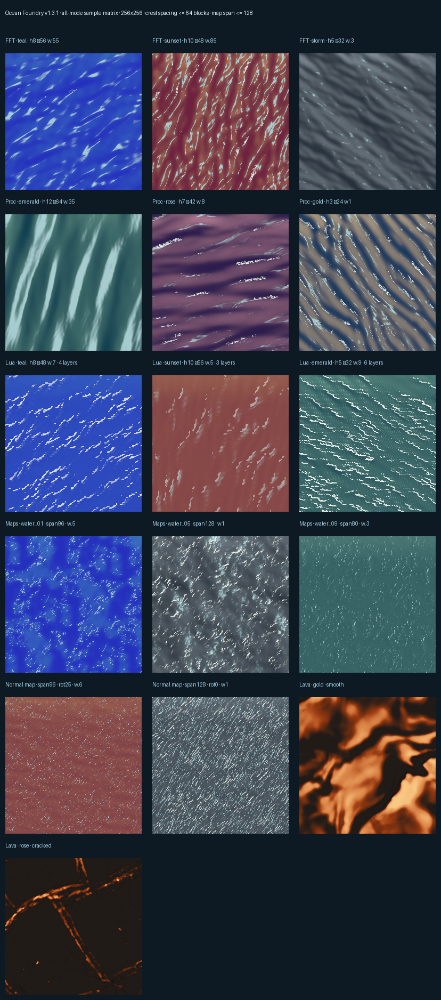

# Ocean Foundry

**Ocean Foundry** is a native Windows desktop tool for building Minecraft Java
**Ocean** and **Lava** surfaces — concrete foundations, coloured solid blocks and
stained glass — with a live colour preview and direct world export.



## Download

Windows x64 portable builds are published on the
[Releases](https://github.com/SirChomuske/ocean-foundry/releases) page.

- [Ocean Foundry v1.3.1 — English](https://github.com/SirChomuske/ocean-foundry/releases/tag/v1.3.1)
- [Ocean Foundry v1.3.1 — 中文](https://github.com/SirChomuske/ocean-foundry/releases/tag/v1.3.1)

Download the ZIP, extract the **whole** folder, and run `Ocean Foundry.exe`.
Settings, imported normal maps and exports stay in that folder.

## Features

- **Three generated wave sources** — FFT ocean spectrum, layered procedural
  waves, and a Lua-style multi-band wave model — plus 13 bundled ocean normal
  maps and imported tangent-space normal maps.
- **Ocean and Lava materials** with concrete foundation shaping, shallow-water
  depth response, foam/whitecaps, reflections and view-dependent lighting.
- **Block-accurate baking** — solid colour matching, ordered stained-glass
  stacks, foam glass, palette dithering and Minecraft Java 26.1.2 block data.
- **Live Colour preview** before baking, plus component maps for colour, normals,
  foam, depth and reflection.
- **Portable exports and profiles** — Litematica structure exports and reusable
  project profiles.
- **English and Chinese** UI and user guides.

## Quick start

1. Choose **Ocean** or **Lava** in the material bar.
2. Pick a normal source: generated (FFT / Procedural / Lua), a bundled map, or
   your own normal map.
3. Shape the foundation, adjust wave size, spacing, wind and colour.
4. Use **Colour preview** to check the target, then **Bake**.
5. Export a Litematica structure or a block palette.

See the [User Guide](USER_GUIDE.md) (or [中文用户指南](USER_GUIDE.zh-CN.md)) for
every control, and [Release Notes](RELEASE_NOTES.md) for version changes.

## Wave spacing

**Wave spacing** (0.5–2.0) changes the spacing of both the concrete foundation
and the shading normal field without changing wave height or normal strength —
useful for matching a build's scale while keeping the same sea state.

## Lua whitecaps

The Lua wave source evaluates foam per wave band and carries the owning band's
crest/compression flags, so whitecaps form a thin, broken line along the crest
instead of broad patches. Lua shading itself uses the normal-map colour and
lighting path used by the other Ocean sources.

## Build from source

Requires Windows x64, Python 3.11+ and PySide6.

```powershell
python -m venv .venv
.venv\Scripts\pip install numpy scipy pillow PySide6 pyinstaller
.venv\Scripts\python launcher.py
```

Release build (onedir, Windows x64):

```powershell
./build.ps1 -Release
```

The packaged runtime is written to `.build/release-runtime/Ocean Foundry`.
Normal maps are loaded from `ocean_normals/` and `lava_normals/`.

## License

Released under the [MIT License](LICENSE). Copyright © 2026 SirChocoo.

Bundled normal-map assets in `ocean_normals/` and `lava_normals/` are original
works by the author and are included under the same MIT license. Third-party
libraries (NumPy, SciPy, Pillow, PySide6/Qt, PyInstaller) retain their own
licenses; the release packages include their notices in `licenses/`.

## Notice

Minecraft is a trademark of Mojang and Microsoft. Ocean Foundry is an
independent project and is not an official Minecraft product, nor affiliated
with or endorsed by Mojang or Microsoft.

Created by SirChocoo.
